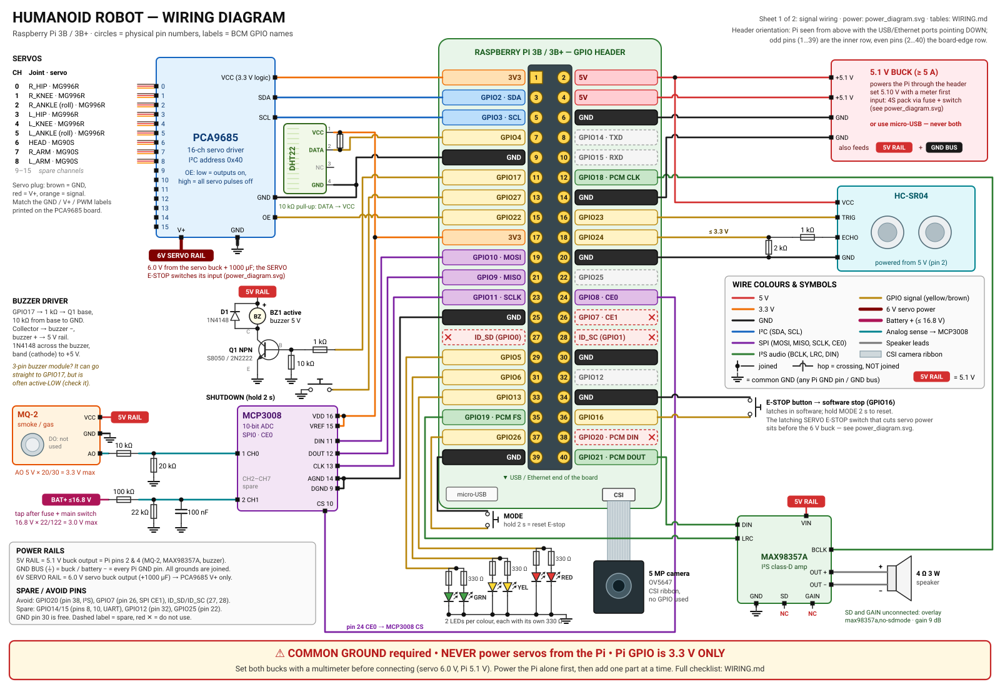
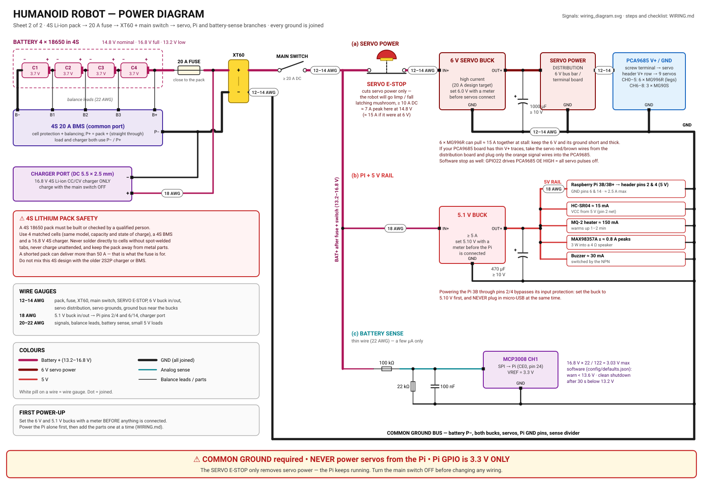

# Wiring guide — Humanoid Robot (Raspberry Pi 3B / 3B+)

This guide tells you where every wire goes. It matches the two diagrams and
the pin map in [`humanoid_robot/config/pins.py`](../humanoid_robot/config/pins.py).
If you change a wire, change all four of them together.

| Diagram | What it shows |
|---|---|
| [wiring_diagram.svg](wiring_diagram.svg) | Sheet 1: every signal wire to the 40-pin header |
| [power_diagram.svg](power_diagram.svg) | Sheet 2: battery, fuse, switches, bucks, grounds and wire sizes |





> **Three rules that protect your parts**
>
> 1. **COMMON GROUND is required.** Every GND (battery, both bucks, servos, Pi, sensors) is joined.
> 2. **Never power servos from the Pi.** Servos get 6 V from their own buck, never from a Pi pin.
> 3. **Pi GPIO is 3.3 V only.** 5 V on any GPIO pin can destroy the Pi. That is why ECHO and the MQ-2 go through dividers.

> **⚠ Battery warning.** A 4S 18650 pack must be **built or checked by a qualified person**.
> Use 4 matched cells (same model, capacity and state of charge), a 4S BMS and a 16.8 V 4S charger.
> Never solder straight onto cells without spot-welded tabs, never charge unattended, and keep the pack away
> from loose metal. A shorted pack can push more than 50 A, which is why the fuse sits next to it.
> Do not mix this 4S design with the older 2S2P charger or BMS.

---

## How to read the pin numbers

There are two ways to number the Pi's pins, and you need both:

* **Physical pin** (1–40): the position on the header. On the diagram it is the number in the gold circle.
* **BCM GPIO number** (for example GPIO17): the name the software uses. It is the text on the coloured label.

Hold the Pi from above with the **USB/Ethernet ports pointing down** (as in the diagram). The header is then
on the right-hand edge of the board. Pin 1 is at the top left and has a **square** solder pad. Odd pins (1, 3 … 39)
are the inner row, and even pins (2, 4 … 40) are the row along the board edge.

On the diagram:

* A **dot** means wires are joined. A small **hop** (a bump in a wire) means two wires cross but are **not** joined.
* **⏚** means common GND: connect it to the GND bus (or any Pi GND pin, since they are all the same).
* **5V RAIL** is the 5.1 V buck output. It is the same 5 V as Pi pins 2 and 4.
* **6V SERVO RAIL** is the 6.0 V servo buck output. It goes to the PCA9685 V+ terminal **only**.
* A dashed label is a spare pin. A label with a red ✕ must not be used.

### Shared pins

A header pin only takes one female jumper. Where two wires go to the same pin (pins 2, 9, 17, 20 and 25),
first join them on the perfboard (solder both to one pad or strip), then run **one** jumper to the pin.

---

## 1. Master pin table

The wire colours below are the ones used in the diagrams. Use the same colours for your jumpers if you can,
because it makes checking much easier.

| Phys. pin | BCM / name | Connects to | Wire colour | Notes |
|---:|---|---|---|---|
| 1 | 3V3 | PCA9685 **VCC** | orange | Logic power for the PCA9685 only (not servo power) |
| 2 | 5V | 5.1 V buck **+** and HC-SR04 **VCC** | red | Shared pin. The buck feeds the Pi here. |
| 3 | GPIO2 · SDA | PCA9685 **SDA** | blue | I²C bus 1, address 0x40 |
| 4 | 5V | 5.1 V buck **+** | red | Second feed from the buck |
| 5 | GPIO3 · SCL | PCA9685 **SCL** | blue | I²C bus 1 |
| 6 | GND | 5.1 V buck **GND** | black | |
| 7 | GPIO4 | DHT22 **DATA** (pin 2) | yellow/brown | 10 kΩ pull-up from DATA to DHT22 VCC (3V3) |
| 8 | GPIO14 · TXD | — | — | Spare (UART) |
| 9 | GND | PCA9685 **GND** and DHT22 **GND** (pin 4) | black | Shared pin |
| 10 | GPIO15 · RXD | — | — | Spare (UART) |
| 11 | GPIO17 | Buzzer driver: **1 kΩ → Q1 base** | yellow/brown | Q1 = S8050 or 2N2222 NPN |
| 12 | GPIO18 · PCM CLK | MAX98357A **BCLK** | green | I²S bit clock |
| 13 | GPIO27 | **SHUTDOWN** button | yellow/brown | Other side of the button to GND. Hold 2 s = clean shutdown |
| 14 | GND | 5.1 V buck **GND** | black | Second ground from the buck |
| 15 | GPIO22 | PCA9685 **OE** | yellow/brown | Active-low: LOW = servo pulses on, HIGH = all off |
| 16 | GPIO23 | HC-SR04 **TRIG** | yellow/brown | |
| 17 | 3V3 | DHT22 **VCC** (pin 1) + 10 kΩ pull-up, MCP3008 **VDD** (16) and **VREF** (15) | orange | Shared pin |
| 18 | GPIO24 | HC-SR04 **ECHO** through the 1 kΩ / 2 kΩ divider | yellow/brown | **Never** connect ECHO directly |
| 19 | GPIO10 · MOSI | MCP3008 **DIN** (11) | purple | SPI0 |
| 20 | GND | HC-SR04 **GND** and the bottom of the 2 kΩ | black | Shared pin |
| 21 | GPIO9 · MISO | MCP3008 **DOUT** (12) | purple | SPI0 |
| 22 | GPIO25 | — | — | Spare |
| 23 | GPIO11 · SCLK | MCP3008 **CLK** (13) | purple | SPI0 |
| 24 | GPIO8 · CE0 | MCP3008 **CS** (10) | purple | The wire runs under the Pi in the diagram |
| 25 | GND | MCP3008 **AGND** (14) and **DGND** (9) | black | Shared pin |
| 26 | GPIO7 · CE1 | — | — | **Do not use** (claimed by the SPI driver) |
| 27 | ID_SD (GPIO0) | — | — | **Do not use** (HAT EEPROM) |
| 28 | ID_SC (GPIO1) | — | — | **Do not use** (HAT EEPROM) |
| 29 | GPIO5 | 2 × **green** LED, each through its own 330 Ω | yellow/brown | Cathodes to GND |
| 30 | GND | — | — | Free GND pin |
| 31 | GPIO6 | 2 × **yellow** LED, each through its own 330 Ω | yellow/brown | Cathodes to GND |
| 32 | GPIO12 | — | — | Spare |
| 33 | GPIO13 | 2 × **red** LED, each through its own 330 Ω | yellow/brown | Cathodes to GND |
| 34 | GND | **E-STOP** button (other side) | black | |
| 35 | GPIO19 · PCM FS | MAX98357A **LRC** | green | I²S word clock |
| 36 | GPIO16 | **E-STOP** button | yellow/brown | Software stop, latches until MODE is held 2 s |
| 37 | GPIO26 | **MODE** button | yellow/brown | Press = next mode, hold 2 s = reset E-stop |
| 38 | GPIO20 · PCM DIN | — | — | **Do not use** (claimed by I²S audio) |
| 39 | GND | **MODE** button (other side) | black | |
| 40 | GPIO21 · PCM DOUT | MAX98357A **DIN** | green | I²S data |

**Connections that do not use the header:**

| From | To | Wire colour | Notes |
|---|---|---|---|
| Camera ribbon | Pi **CSI** connector | (ribbon) | No GPIO pins used |
| 5V RAIL (5.1 V buck output) | MQ-2 VCC, MAX98357A VIN, buzzer + | red | Same 5 V as pins 2 and 4 |
| GND bus (⏚) | MQ-2 GND, MAX98357A GND, Q1 emitter, 10 kΩ base resistor, LED cathodes, SHUTDOWN button, MQ-2 and battery divider bottoms, PCA9685 servo GND terminal | black | Joined to the battery negative and both bucks |
| 6V SERVO RAIL | PCA9685 **V+** terminal | dark red | 6.0 V servo buck output + 1000 µF |
| BAT+ (after fuse + main switch) | 100 kΩ of the battery divider | magenta | Divider output to MCP3008 CH1 (teal) |

**Wire colour key:** 5 V red · 3.3 V orange · GND black · I²C blue · SPI purple · I²S green ·
GPIO signal yellow/brown · 6 V servo power dark red · battery + magenta · analog sense teal · speaker leads grey.

---

## 2. Servo channel table

The servos plug into the PCA9685 3-pin headers. Servo wires: **brown = GND, red = V+, orange = signal**.
Match them to the GND / V+ / PWM labels printed on your PCA9685 board.

| PCA9685 channel | Joint | Servo | Notes |
|---:|---|---|---|
| 0 | R_HIP | MG996R | Right leg |
| 1 | R_KNEE | MG996R | Right leg |
| 2 | R_ANKLE (roll) | MG996R | Right leg |
| 3 | L_HIP | MG996R | Left leg |
| 4 | L_KNEE | MG996R | Left leg |
| 5 | L_ANKLE (roll) | MG996R | Left leg |
| 6 | HEAD | MG90S | |
| 7 | R_ARM | MG90S | |
| 8 | L_ARM | MG90S | |
| 9–15 | — | — | Spare |

Label each servo cable with its channel number before you plug it in.

---

## 3. Component by component

Do these one at a time, with **all power off**. After each part, check it with the pre-power checklist
(section 5) before you add the next one.

### 3.1 PCA9685 servo driver (I²C 0x40)

```
 Pi header                    PCA9685
 pin 1  3V3   ───orange────►  VCC    (3.3 V logic only)
 pin 3  SDA   ───blue──────►  SDA
 pin 5  SCL   ───blue──────►  SCL
 pin 9  GND   ───black─────►  GND
 pin 15 GPIO22 ──yel/brn───►  OE     (LOW = servos on, HIGH = all off)

 6V SERVO RAIL ══dark red══►  V+  ┐ screw terminal
 GND bus      ══black═════►  GND ┘  (12–14 AWG)
                              CH0…CH8 ──► 9 servos (see section 2)
```

1. Connect **VCC** to pin 1 (3V3). This is logic power only.
2. Connect **SDA** to pin 3 and **SCL** to pin 5.
3. Connect the logic **GND** (next to VCC) to pin 9. The DHT22 GND shares this pin.
4. Connect **OE** to pin 15 (GPIO22). When the program sets it HIGH, every servo pulse stops at once.
5. Connect the **V+ / GND screw terminal** to the 6V SERVO RAIL and the GND bus with 12–14 AWG wire.

   **Never** connect V+ to the Pi's 5 V or 3V3.
6. Plug in the servos as listed in section 2.

### 3.2 DHT22 temperature / humidity

```
          DHT22 (grille facing you, legs down: 1 2 3 4)
 pin 17 3V3 ──orange──┬──────────► 1 VCC
                      R1 10 kΩ
 pin 7 GPIO4 ─yel/brn─┴──────────► 2 DATA
                                   3 NC (not connected)
 pin 9 GND ───black──────────────► 4 GND
```

1. Connect DHT22 pin 1 (**VCC**) to Pi pin 17 (3V3).
2. Connect DHT22 pin 2 (**DATA**) to Pi pin 7 (GPIO4).
3. Fit a **10 kΩ** resistor between DATA and VCC (the pull-up).
4. Leave pin 3 unconnected.
5. Connect DHT22 pin 4 (**GND**) to Pi pin 9.

> A DHT22 *module* on a small board usually has only 3 pins and often already has the pull-up fitted.
> If yours does, skip step 3.

### 3.3 HC-SR04 ultrasonic sensor (with the ECHO divider)

```
 pin 2  5V   ───red──────────────────────────► VCC
 pin 16 GPIO23 ─yel/brn──────────────────────► TRIG
 pin 18 GPIO24 ─yel/brn──●──[ 1 kΩ ]─────────◄ ECHO   (5 V signal)
                         │
                       [ 2 kΩ ]   node = 5 V × 2/3 = 3.3 V
                         │
 pin 20 GND  ───black────●───────────────────► GND
```

1. Connect **VCC** to pin 2 (5 V). Pin 2 is shared with the 5.1 V buck feed.
2. Connect **TRIG** to pin 16 (GPIO23). TRIG can be driven straight from 3.3 V.
3. Build the divider: **1 kΩ** from ECHO to a middle point (the "node"), then **2 kΩ** from the node to GND.
4. Connect the **node** (not ECHO itself) to pin 18 (GPIO24).
5. Connect **GND** and the bottom of the 2 kΩ to pin 20.

The ECHO pin outputs 5 V. Connecting it straight to GPIO24 can damage the Pi.

### 3.4 MCP3008 ADC, MQ-2 gas sensor and battery sense

```
 MCP3008 (DIP-16, notch up)          Pi / other
 16 VDD  ◄──orange── pin 17 3V3
 15 VREF ◄──orange── pin 17 3V3 (joined to VDD)
 14 AGND ───black──► pin 25 GND
 13 CLK  ◄──purple── pin 23 GPIO11 SCLK
 12 DOUT ───purple─► pin 21 GPIO9  MISO
 11 DIN  ◄──purple── pin 19 GPIO10 MOSI
 10 CS   ◄──purple── pin 24 GPIO8  CE0
  9 DGND ───black──► pin 25 GND (joined to AGND)

 CH0 (pin 1):  MQ-2 AO ──[ 10 kΩ ]──●──► CH0
                                    └─[ 20 kΩ ]── GND

 CH1 (pin 2):  BAT+ ──[ 100 kΩ ]──●──────────► CH1
                                  ├─[ 22 kΩ ]── GND
                                  └─|| 100 nF ─ GND
```

**MCP3008 chip**

1. Connect **VDD (16)** and **VREF (15)** together, then to pin 17 (3V3).
2. Connect **AGND (14)** and **DGND (9)** together, then to pin 25 (GND).
3. Connect **CLK (13)** to pin 23, **DOUT (12)** to pin 21, **DIN (11)** to pin 19 and **CS (10)** to pin 24.
4. CH2–CH7 (pins 3–8) are spare. Leave them unconnected.

**MQ-2 on CH0**

5. MQ-2 **VCC** goes to the 5V RAIL and MQ-2 **GND** to the GND bus. The heater takes about 150 mA and needs

   1–2 minutes to warm up.
6. MQ-2 **AO** goes to a **10 kΩ** resistor. From the other end (the node), a **20 kΩ** resistor goes to GND.
7. Connect the node to **CH0 (pin 1)**. MQ-2 **DO** is not used.

   5 V × 20/30 = 3.3 V maximum. If the 5V RAIL is 5.1 V, the worst case is 3.4 V. That only clips the reading at
    full scale and is still inside the MCP3008's safe input limit (VDD + 0.6 V). In clean air AO is far lower.

**Battery voltage on CH1**

8. Run a thin wire (22 AWG) from **BAT+ after the fuse and the main switch** to a **100 kΩ** resistor.
9. From the other end (the node), connect **22 kΩ** to GND and a **100 nF** capacitor to GND.
10. Connect the node to **CH1 (pin 2)**.

    16.8 V × 22/122 = 3.03 V at a full pack. The software warns below 13.6 V and shuts down cleanly after
      30 s below 13.2 V (`battery_warning_v` / `battery_shutdown_v` in `config/defaults.json`).

### 3.5 MAX98357A I²S amplifier and speaker

```
 pin 12 GPIO18 ─green──► BCLK          OUT+ ───grey──► speaker +
 pin 35 GPIO19 ─green──► LRC           OUT− ───grey──► speaker −
 pin 40 GPIO21 ─green──► DIN                 (4 Ω, 3 W)
 5V RAIL ──────red─────► VIN
 GND bus ──────black───► GND
                         SD    ── not connected
                         GAIN  ── not connected (9 dB)
```

1. Connect **BCLK** to pin 12, **LRC** to pin 35 and **DIN** to pin 40.
2. Connect **VIN** to the 5V RAIL and **GND** to the GND bus, not to a thin Pi pin, because loud sounds pull

   up to about 0.8 A.
3. Leave **SD** and **GAIN** unconnected. The audio overlay is `max98357a,no-sdmode`, because the overlay's

   default SD pin (GPIO4) is the DHT22 pin. GAIN left open gives 9 dB.
4. Screw the **4 Ω 3 W speaker** to the **+** and **−** output terminals. Neither output is ground, so never

   connect a speaker wire to GND.

### 3.6 Active buzzer (NPN driver)

```
 5V RAIL ─red──┬────────────┐
               │            │
          1N4148 ▲        (+)
        (band up)│      BUZZER
               │        (−)
               └────────────┤
                            C
 pin 11 GPIO17 ─yel/brn─[ 1 kΩ ]─●─ B   Q1 S8050 / 2N2222
                                 │  E
                              [10 kΩ]  │
                                 │     │
                                GND   GND
```

1. Connect buzzer **+** to the 5V RAIL.
2. Connect buzzer **−** to the **collector (C)** of Q1.
3. Connect the **emitter (E)** of Q1 to GND.
4. Connect GPIO17 (pin 11) through a **1 kΩ** resistor to the **base (B)**.
5. Fit a **10 kΩ** resistor from the base to GND. It keeps the buzzer off while the Pi boots.
6. Fit a **1N4148** diode across the buzzer, with the **band (cathode) to +5 V**.

Check the C-B-E order in your transistor's datasheet, because it differs between makers.

> **3-pin buzzer module?** It already has a transistor and can go straight to GPIO17 (with VCC and GND).
> Many of these modules are **active-LOW** (they beep when the pin is LOW), so test it before you rely on it.

### 3.7 Status LEDs (2 per colour)

```
 pin 29 GPIO5  ─yel/brn─┬─[330 Ω]─►|─ GND   green
                        └─[330 Ω]─►|─ GND   green
 pin 31 GPIO6  ─yel/brn─┬─[330 Ω]─►|─ GND   yellow
                        └─[330 Ω]─►|─ GND   yellow
 pin 33 GPIO13 ─yel/brn─┬─[330 Ω]─►|─ GND   red
                        └─[330 Ω]─►|─ GND   red
                         (long leg = anode, flat side / short leg = cathode)
```

1. For each colour, split the GPIO wire into two branches.
2. Each branch gets its **own 330 Ω** resistor, then one LED. The anode (long leg) faces the resistor.
3. Join all six cathodes (short leg, flat side) to the GND bus.

Never share one resistor between two LEDs. Two LEDs on one pin take about 8 mA in total, which is safe for the Pi.

### 3.8 Buttons (to GND, internal pull-ups)

```
 pin 36 GPIO16 ─yel/brn─┤ E-STOP ├─black─ pin 34 GND
 pin 37 GPIO26 ─yel/brn─┤  MODE  ├─black─ pin 39 GND
 pin 13 GPIO27 ─yel/brn─┤SHUTDOWN├─black─ GND bus
```

| Button | Signal | Other side | What it does |
|---|---|---|---|
| E-STOP | pin 36 (GPIO16) | pin 34 (GND) | Software stop. It stays latched until MODE is held for 2 s |
| MODE | pin 37 (GPIO26) | pin 39 (GND) | Press = next mode, hold 2 s = reset the E-stop |
| SHUTDOWN | pin 13 (GPIO27) | GND bus | Hold 2 s = clean shutdown (kernel `gpio-shutdown` overlay) |

No resistors are needed, because the Pi's internal pull-ups are switched on. Each button pulls its pin to GND when pressed.

> The **E-STOP button** is a software input. The separate, latching **SERVO E-STOP** switch in the power
> wiring (section 4) cuts the servo power itself. Fit both.

### 3.9 Camera (5 MP OV5647)

1. Power off. Lift the CSI connector's latch, which is the slot marked CAMERA between the HDMI and audio jacks.
2. Insert the ribbon with the **silver contacts facing the HDMI port** (the blue stiffener faces the USB/Ethernet

   ports). Push the latch down.
3. The camera end usually comes fitted. If you refit it, follow the guide that came with your camera.

The camera uses no GPIO pins. The ribbon is fragile: do not fold it sharply.

### 3.10 Pi power

```
 5.1 V buck +  ──red (18 AWG)───► pin 2 and pin 4  (5 V)
 5.1 V buck −  ──black (18 AWG)─► pin 6 and pin 14 (GND)
```

1. Set the 5.1 V buck to **5.10 V** with a multimeter **before** the Pi is connected.
2. Run two red wires to pins 2 and 4, and two black wires to pins 6 and 14.
3. The same buck output is the **5V RAIL** for the MQ-2, MAX98357A and buzzer.

Powering through pins 2/4 bypasses the Pi 3B's input protection. That is why the buck must be set correctly
first. You can power the Pi through **micro-USB** instead, but **never both at the same time**.

---

## 4. Power wiring

Follow [power_diagram.svg](power_diagram.svg). Build this with the pack **disconnected** (XT60 unplugged).

```
 4 × 18650 (4S) ─► 4S 20 A BMS ─► 20 A FUSE ─► XT60 ─► MAIN SWITCH ─► BAT+ bus (13.2–16.8 V)
                                     │
                    charger port ────┘ (+ after the fuse, − to BMS P−)

 BAT+ bus ─┬─► (a) SERVO E-STOP ─► 6 V buck ─► 1000 µF ─► servo distribution ─► PCA9685 V+ ─► 9 servos
           ├─► (b) 5.1 V buck ─► 470 µF ─► Pi pins 2/4 + 5V RAIL (HC-SR04, MQ-2, MAX98357A, buzzer)
           └─► (c) 100 kΩ / 22 kΩ + 100 nF ─► MCP3008 CH1

 Battery P−, both bucks, servo GND, Pi GND, divider ─► COMMON GROUND BUS
```

### 4.1 Battery, BMS and fuse

1. **4 × 18650 in 4S**: 14.8 V nominal, 16.8 V full, about 13.2 V when it is time to stop.
2. **4S 20 A BMS (common port)**. Balance leads (22 AWG) go to B−, B1, B2, B3 and B+, in cell order.

   Pack − goes to B− with thick wire. **P−** is the output and charge negative. **P+** is simply pack +.
3. **20 A fuse** on the + wire, as **close to the pack** as possible.
4. **XT60** connector, then the **main switch** (rated ≥ 20 A DC). This gives the **BAT+ bus**.

### 4.2 Charger port

* DC jack 5.5 × 2.5 mm. **+** joins the + wire **after the fuse**, and **−** goes to the BMS **P−**. Use 18 AWG.
* Use only a **16.8 V 4S Li-ion CC/CV charger**. Charge with the main switch **OFF**, and never leave it unattended.

### 4.3 Branch (a): servos

**BAT+ → SERVO E-STOP → 6 V buck IN → 1000 µF → servo distribution board → PCA9685 V+ → 9 servos**

* **SERVO E-STOP (cuts servo power only, the robot will go limp/fall).** Use a latching mushroom switch
rated ≥ 10 A DC. It sits on the **input** side of the 6 V buck. At 14.8 V it carries only about 7 A at peak,
instead of about 15 A on the 6 V side, so a normal 10 A E-stop is enough. The Pi keeps running when it is pressed.
* **6 V servo buck**: high current (20 A design target). Set it to **6.0 V** with a meter before any servo is connected.
* **1000 µF** electrolytic capacitor (≥ 10 V, + to 6 V) across the output, close to the servos.
* **Servo distribution board**, then the **PCA9685 V+ / GND** screw terminal.
* The 6 × MG996R can pull about 15 A together at stall, so keep these wires short and use 12–14 AWG.
If your PCA9685 board has thin V+ traces, take the servos' red and brown wires from the distribution board
and plug only the orange signal wires into the PCA9685.
* Before releasing the SERVO E-STOP, support the robot. The servos jump to their last commanded position.
The software can also cut every servo pulse with GPIO22 → PCA9685 OE.

### 4.4 Branch (b): Pi and 5 V rail

**BAT+ → 5.1 V buck (≥ 5 A) → 470 µF → Pi pins 2/4 and the 5V RAIL**

| Load | Current | Wire |
|---|---|---|
| Raspberry Pi 3B/3B+ (pins 2 & 4, GND pins 6 & 14) | ≈ 2.5 A max | 18 AWG |
| HC-SR04 (VCC on pin 2) | ≈ 15 mA | 22 AWG |
| MQ-2 heater | ≈ 150 mA | 22 AWG |
| MAX98357A | ≤ ≈ 0.8 A peaks | 20 AWG |
| Buzzer (through Q1) | ≈ 30 mA | 22 AWG |

The 470 µF electrolytic (≥ 10 V, + to 5 V) goes across the buck output.

### 4.5 Branch (c): battery sense

BAT+ (after the fuse and the switch) → **100 kΩ** → node → **22 kΩ** and **100 nF** to GND. The node goes to
**MCP3008 CH1**. Use thin wire (22 AWG), since only a few microamps flow. See section 3.4.

### 4.6 Common ground bus

One thick GND bus (12–14 AWG near the bucks) joins **battery P−**, **both buck grounds**, the **servo GND**,
the **Pi GND pins (6 and 14)** and the **divider grounds**. All the Pi's GND pins are already joined inside the Pi.
Without a common ground, the PCA9685 and the sensors cannot read the Pi's signals.

### 4.7 Wire gauges

| Gauge | Use it for |
|---|---|
| **12–14 AWG** | Pack, fuse, XT60, main switch, SERVO E-STOP, 6 V buck in/out, servo distribution, servo grounds, ground bus near the bucks |
| **18 AWG** | 5.1 V buck in/out to Pi pins 2/4 and 6/14, charger port |
| **20–22 AWG** | Signals, balance leads, battery sense, small 5 V loads |

---

## 5. Pre-power checklist

Do this **before the first power-up** and again after every wiring change.

**With everything unpowered (XT60 unplugged):**

- [ ] Set both buck outputs with a multimeter **before connecting anything to them**: the servo buck to **6.0 V**
  ```
  and the Pi buck to **5.1 V**. Then disconnect the pack again.
  ```
- [ ] Continuity (beep) test: there must be **no short** between **5 V and GND**, **3V3 and GND**, or **5 V and 3V3**.
  ```
  Also check BAT+ to GND and 6 V to GND.
  ```
- [ ] Check every row of the master pin table (section 1) against your wiring. Tick each pin.
- [ ] The HC-SR04 ECHO goes to the divider, **not** straight to pin 18.
- [ ] Nothing from the 6V SERVO RAIL touches the Pi or the PCA9685 VCC pin.
- [ ] All grounds are joined (battery P−, both bucks, servos, Pi).
- [ ] The camera ribbon is fully seated and its latch is closed.

**Power up step by step:**

- [ ] **Power the Pi alone first**: only the 5.1 V buck connected, nothing on the header. It must boot normally.
- [ ] Then **add the parts one at a time**, powering down between each: PCA9685 (no servos), DHT22, HC-SR04,
  ```
  MCP3008 + MQ-2 + battery sense, MAX98357A, buzzer, LEDs, buttons, camera, and finally the servos.
  ```
- [ ] **HC-SR04**: with it powered, measure **ECHO at the GPIO side** of the divider (pin 18) while it measures.
  ```
  It must be **≤ 3.3 V**.
  ```
- [ ] **MCP3008**: measure **CH0 and CH1**. Both must be **≤ 3.3 V** (CH1 is about 3.0 V with a full pack).
- [ ] Press the **SERVO E-STOP**. The servos must go limp while the Pi keeps running. Release it only with the
  ```
  robot supported.
  ```

If something gets hot, smells or the Pi will not boot, switch off at the main switch at once. Then see
[TROUBLESHOOTING.md](TROUBLESHOOTING.md).
